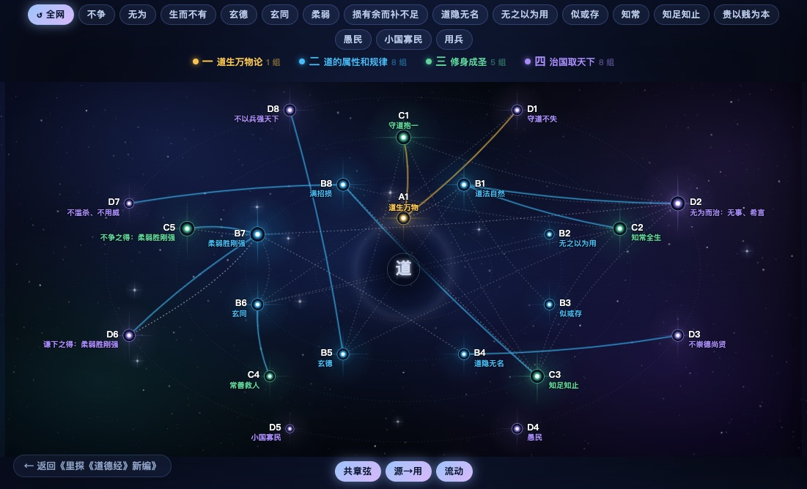

<!--  -->

# 里探《道德经》 新编

> 反者，道之动。弱者，道之用。天下万物生于有，有生于无。

- 原文：李耳｜新编：里探｜修订于 2026/10/15　
- 分享给喜欢《道德经》的朋友们
- 关注里探。与你共同阅读思考进步

  

    
4 部 · 22 组 · 81 章

    <h2 class="cover-star-title">天道星图</h2>
    
文字是线性的，星图是整体的。点一个节点，读这一组的全部原文与评说。

    

      <a class="cover-star-primary" href="tian-wang.html" target="_self">进入星图 →</a>
      <a class="cover-star-secondary" href="#/00">从第一章读起</a>
    

  

  <a class="cover-star-media" href="tian-wang.html" target="_self" aria-label="打开天道星图">
    
    点节点读原文
  </a>

